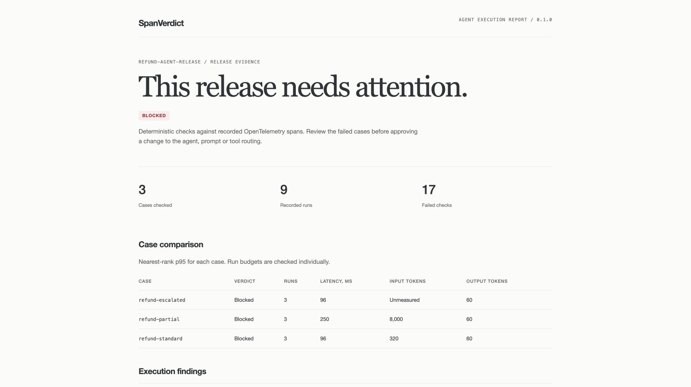
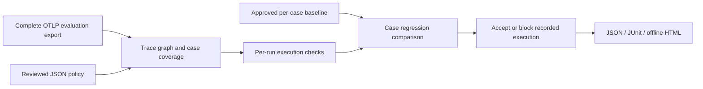

# SpanVerdict

**Check the agent's execution before shipping a change.**

[](https://github.com/ABRJrocks/spanverdict/actions/workflows/ci.yml)
[](pyproject.toml)
[](LICENSE)

SpanVerdict turns recorded OpenTelemetry agent traces into a local CI release check. Define the expected cases, measured budgets and tool requirements, then compare a candidate against a reviewed per-case baseline.

A refund agent can call `apply_refund` before `check_eligibility`, loop through extra model calls, or lose token telemetry after an instrumentation change. SpanVerdict reports the affected case and recorded execution rule, then returns a failing exit code.

It requires no service account, API key or runtime dependency. Use it alongside Langfuse, Phoenix or your own answer evaluators.



## Try the executable example

Requires Python 3.10+. There is no PyPI publication yet. Install from this repository or use a wheel attached to the [GitHub releases](https://github.com/ABRJrocks/spanverdict/releases).

```sh
git clone https://github.com/ABRJrocks/spanverdict.git
cd spanverdict
python -m venv .venv
source .venv/bin/activate
python -m pip install .

spanverdict check examples/refund-policy.json examples/good.jsonl \
  --baseline examples/approved-baseline.json \
  --json-report reports/good.json --junit reports/good.xml \
  --html-report reports/good.html
```

On Windows, activate with `.venv\Scripts\Activate.ps1`. The example contains three synthetic refund cases with three independent runs each:

```text
PASS refund-escalated: runs=3 failed_checks=0
PASS refund-partial: runs=3 failed_checks=0
PASS refund-standard: runs=3 failed_checks=0
ACCEPTED recorded execution
```

Run the deliberately broken candidate:

```sh
spanverdict check examples/refund-policy.json examples/broken.jsonl \
  --baseline examples/approved-baseline.json \
  --json-report reports/broken.json --junit reports/broken.xml \
  --html-report reports/broken.html
```

It exits **1** and produces **17 failed checks**: early refund execution, token/latency budget overruns and baseline regressions, an unexpected tool, and missing input usage. Open `reports/broken.html` to inspect the case comparison and each recorded run. The examples make no model, payment or customer-system calls.

## What it checks

| Concern | Recorded evidence |
| --- | --- |
| Missing evaluation cases | Exact expected case set and minimum independent runs per case |
| Incomplete export | Root/parent identity, graph cycles, dropped attributes and completed intervals |
| Unmeasured tokens | Missing usage stays unmeasured; requested usage checks fail |
| Token and latency overruns | Inclusive limits on every individual run |
| Absent instrumentation | Minimum model/tool activity where the contract requires it |
| Unexpected tool routing | Explicit executed-tool allow list and attempt caps |
| Required tool execution | Minimum counts with explicit successful status |
| Prerequisite ordering | Successful prerequisite ends before each dependent tool starts |
| Case regressions | Per-case nearest-rank p95 against a reviewed baseline and explicit allowance |
| CI evidence | Nonzero exit codes, JSON, JUnit and self-contained HTML |



## A small contract

```json
{
  "version": 1,
  "name": "support-agent",
  "cases": ["refund-standard", "refund-escalated"],
  "min_runs_per_case": 3,
  "minimums": {"model_calls": 1},
  "limits": {"input_tokens": 1500, "duration_ms": 8000, "error_spans": 0},
  "tools": {
    "allow": ["lookup_customer", "check_eligibility", "apply_refund", "escalate_case"],
    "required": {"lookup_customer": 1, "check_eligibility": 1},
    "max_calls": {"apply_refund": 1}
  },
  "order": [{"before": "check_eligibility", "after": "apply_refund"}],
  "regressions": {"input_tokens": {"relative": 0.1, "absolute": 20}}
}
```

Each evaluation root records `spanverdict.case_id` and `gen_ai.operation.name=invoke_agent`. Generation spans record their operation and both token directions. Tool spans record `execute_tool`, the tool name and status. Flush a complete unsampled export before checking it. [The contract reference](docs/contracts.md) defines the supported profile and exact semantics.

## Capture a reviewed baseline

```sh
spanverdict lint contracts/agent.json
spanverdict baseline contracts/agent.json artifacts/reviewed-run.jsonl \
  --output contracts/approved-baseline.json
```

Capture refuses failing or incomplete runs. Existing baselines require explicit `--replace`. Review the source run and commit the approved artifact through your normal code-review process. Candidate CI should read that artifact rather than approving its own measurements.

The baseline records per-case metrics, run coverage, a policy fingerprint and an evidence-projection fingerprint. A changed contract requires a new reviewed baseline. Comparison uses `baseline + max(relative allowance, absolute allowance)` for each selected metric.

## GitHub Actions

Check out your evaluation files and set up Python 3.10+ before this step:

```yaml
- uses: ABRJrocks/spanverdict@v0.1.0
  with:
    policy: contracts/agent.json
    traces: artifacts/candidate.jsonl
    baseline: contracts/approved-baseline.json
    report-prefix: reports/agent
```

Pin a reviewed commit SHA for reproducible workflows. The Action installs no packages and uploads no artifacts itself. Use a separate artifact step with `if: always()` to preserve normal rejection reports. [Complete workflow, Python API and OpenTelemetry recipes](docs/integrations.md).

## Verified SDK integration

```sh
python -m pip install -r requirements-integration.txt
python examples/otel_sdk_export.py --output candidate.jsonl
spanverdict check examples/refund-policy.json candidate.jsonl \
  --baseline examples/approved-baseline.json
```

This example emits **real OpenTelemetry Python SDK spans** around **synthetic agent operations** and serializes them through the actual OTLP encoder. The integration test checks both accepted and rejected runs with SDK 1.45.1. Core validation remains independent of the SDK.

## Documentation and verification

- [Contract fields, token coverage, ordering and baseline semantics](docs/contracts.md)
- [CLI, GitHub Actions, Python and Collector integration](docs/integrations.md)
- [Research and existing alternatives](docs/research.md)
- [Security and operational limits](SECURITY.md)
- [Data handling notice](PRIVACY.md)
- [Contributing and validation commands](CONTRIBUTING.md)

The repository includes **81 core tests** plus the real SDK integration test. CI checks Linux on Python 3.10/3.12/3.13, Windows and macOS on Python 3.12, the installed wheel, and the actual composite Action's acceptance/rejection paths.

```sh
python -m unittest discover -s tests -v
python -m unittest discover -s tests_integration -v
```

**Status: 0.1.0 prerelease.** This checks recorded behavior. Sampling, omitted operations and inaccurate instrumentation can hide failures. Tool ordering is an observation, not a runtime authorization mechanism. P95 comparisons are operational thresholds, not significance tests. Token counts are usage rather than inferred currency cost. Production agent integration must be validated with your own instrumentation and evaluators.

MIT licensed. Built and maintained by [Abdul Rafay](https://www.rafayai.dev).
